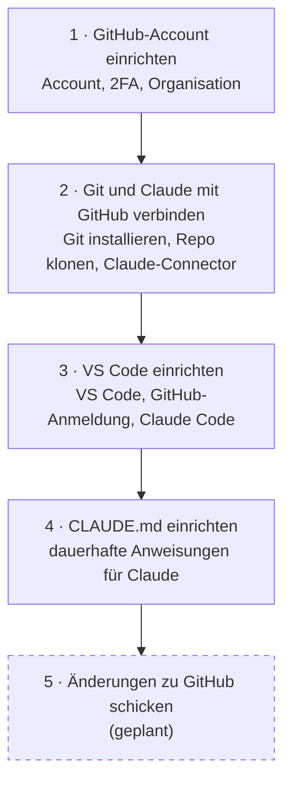
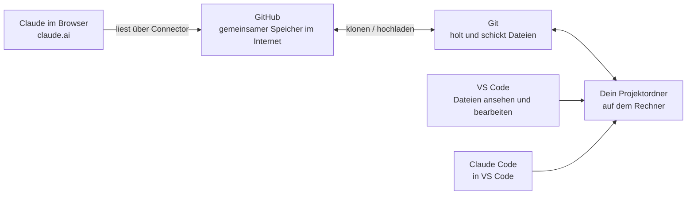

# Übersicht: Welche Anleitung kommt wann?

Die Anleitungen bauen aufeinander auf. Arbeite sie am besten in dieser Reihenfolge durch.
Klicke auf einen Kasten oder auf einen Link in der Liste darunter, um die Anleitung zu öffnen.

> **Hinweis:** Nicht jede Ansicht unterstützt Klicks im Bild (GitHub zum Beispiel nicht). Nutze dann die Liste.

## Die Reihenfolge

| Schritt | Anleitung | Darum geht es | Dauer |
|---|---|---|---|
| 1 | [GitHub-Account einrichten](github-account-einrichten.md) | Account anlegen, Zwei-Faktor-Authentifizierung (2FA) einrichten, der Organisation beitreten | ca. 15 Min. |
| 2 | [Git und Claude mit GitHub verbinden](git-und-claude-mit-github-verbinden.md) | Git installieren, ein Repository auf den Rechner holen, Claude im Browser mit GitHub verbinden | ca. 20 Min. |
| 3 | [VS Code einrichten](vs-code-einrichten.md) | VS Code installieren, mit GitHub anmelden, Erweiterung Claude Code einrichten | ca. 20 Min. |
| 4 | [CLAUDE.md einrichten](claude-md-einrichten.md) | Claude dauerhafte Regeln für ein Projekt mitgeben | ca. 10 Min. |
| 5 | Änderungen zu GitHub schicken | *geplant* | |

*Warum diese Reihenfolge?* Jeder Schritt braucht den vorherigen. Ohne GitHub-Account kein Zugriff auf Repositories. Ohne Git kann VS Code keine Repositories holen. Und die CLAUDE.md wirkt erst, wenn Claude in deinem Projektordner arbeitet.

## Wie hängt das alles zusammen?

Vier Bausteine arbeiten zusammen:

- **GitHub** ist der gemeinsame Speicher im Internet. Ein Projektordner dort heißt **Repository** (kurz: Repo).
- **Git** ist ein kleines Programm auf deinem Rechner. Es holt die Dateien aus GitHub und schickt deine Änderungen zurück.
- **VS Code** ist das Programm, in dem du die Dateien auf deinem Rechner ansiehst und bearbeitest.
- **Claude** gibt es auf zwei Wegen:
  - **Im Browser** (<https://claude.ai>): Claude liest Dateien direkt aus GitHub. Claude kann dort nur lesen, nicht ändern (Schritt 2).
  - **In VS Code** (Erweiterung Claude Code): Claude arbeitet in deinem Projektordner. Claude kann Dateien lesen und, wenn du zustimmst, auch ändern (Schritt 3).
- Die **CLAUDE.md** ist eine Datei im Projektordner. Claude Code liest sie zu Beginn jeder Sitzung (Schritt 4).

> **Faustregel:** Willst du nur Fragen zu Dateien stellen, reicht Claude im Browser. Willst du Dateien gemeinsam mit Claude bearbeiten, nutze Claude Code in VS Code.
