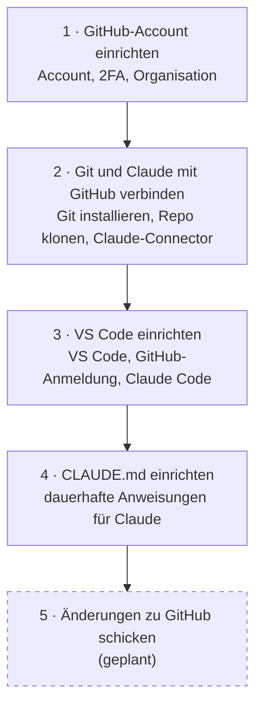
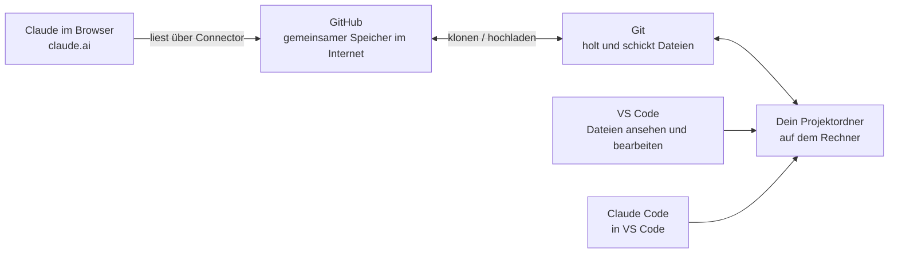

# Übersicht: Warum, Use Cases und Reihenfolge

> **Vorher:** Kläre, welche Daten und Tools du mit Claude nutzen darfst. Vertrauliche und personenbezogene Daten gehören nicht in Claude.

Hier erfährst du, was dir die Verbindung von GitHub, VS Code und Claude bringt, was du damit machen kannst und in welcher Reihenfolge du die Anleitungen durcharbeitest.

## Warum das Ganze?

Du musst keinen Code schreiben, damit sich die Verbindung lohnt. Sie bringt dir vor allem vier Dinge:

1. **Claude sieht die echten Dateien.** Du musst nichts kopieren und einfügen. Claude arbeitet mit dem aktuellen Stand des Projekts, nicht mit einer alten Kopie.
2. **Du kannst selbst nachsehen.** Fragen zum Produkt beantwortest du direkt aus den Dateien. Du musst dafür nicht immer Entwickler:innen unterbrechen.
3. **Nichts geht verloren.** GitHub speichert jede Änderung mit Datum und Namen. Du kannst jederzeit zu einem früheren Stand zurück.
4. **Alle arbeiten am selben Ort.** Konzepte, Anleitungen und Code liegen zusammen im Repository. Das Team findet alles an einer Stelle.

> **Wichtig:** Du behältst die Kontrolle. Claude fragt, bevor es etwas ändert. Und Änderungen am Produkt schickst du als **Pull Request** (ein Änderungsvorschlag auf GitHub). Das Entwicklungsteam prüft den Vorschlag, bevor er übernommen wird.

## Use Cases für Produktmanager:innen

Diese Beispiele brauchen wenig oder gar keine Programmierkenntnisse. Die Spalte **Womit** zeigt, was du dafür brauchst:
- **Browser** heißt Claude auf <https://claude.ai> mit GitHub-Connector (ab Schritt 2).
- **VS Code** heißt Claude Code in VS Code (ab Schritt 3).

### Warum manches nur mit VS Code geht

Beide Wege haben Zugriff auf das Repo. Sie sehen aber nicht dasselbe:

| | Browser | VS Code |
|---|---|---|
| Welche Dateien sieht Claude? | Nur die Dateien und Ordner, die du im Connector **auswählst**. Alles muss gleichzeitig in Claudes Arbeitsspeicher passen. Bei großen Repos geht das nicht. | Das **ganze Repo** auf deinem Rechner. Claude sucht selbst und liest nur, was es gerade braucht. |
| Wie aktuell ist der Stand? | Der Stand vom letzten **Sync**. Den startest du selbst. | Der Stand vom letzten Holen der Änderungen (`git pull`). |
| Sieht Claude den Verlauf? | Nein. Nur den aktuellen Inhalt der Dateien, ohne Änderungsverlauf. | Ja. Claude sieht, wer wann was geändert hat. |
| Kann Claude Dateien ändern? | Nein. Claude liest nur. | Ja. Claude fragt vorher. |

Daraus folgt:

- **Aufwand einschätzen** und **Anforderung mit dem Ist-Stand abgleichen** gehen nur mit VS Code. Claude muss dafür alle Stellen finden, die mit einem Thema zu tun haben. Diese Stellen verteilen sich oft über viele Dateien, die aufeinander verweisen. Im Browser findet Claude nur, was du vorher ausgewählt hast. Was du nicht ausgewählt hast, fehlt in der Antwort, ohne dass Claude es merkt.
- **Release Notes** brauchen den Änderungsverlauf. Den gibt der Browser-Connector nicht weiter.
- **Selbst Änderungen machen** geht nur mit VS Code, weil Claude im Browser keine Dateien ändern kann.
- Für Fragen zu **einzelnen Features** reicht der Browser, wenn du die passenden Dateien auswählst.

### Verstehen und nachfragen

| Use Case | So kannst du fragen | Womit |
|---|---|---|
| Ein Feature verstehen | „Erkläre mir ohne Fachbegriffe, wie die Anmeldung funktioniert.“ | Browser oder VS Code |
| Regeln im Produkt finden | „Welche Pflichtfelder hat das Antragsformular und welche Prüfungen gibt es?“ | Browser oder VS Code |
| Neu im Team einsteigen | „Gib mir einen Überblick über dieses Repo: Was liegt wo, was ist wichtig?“ | Browser oder VS Code |
| Aufwand besser einschätzen | „Welche Teile des Produkts wären betroffen, wenn wir ein drittes Login-Verfahren einführen?“ | VS Code: durchsucht das ganze Repo |
| Gespräche mit der Entwicklung vorbereiten | „Welche offenen Fragen sollte ich zu diesem Feature stellen?“ | Browser oder VS Code |

### Anforderungen und Planung

| Use Case | So kannst du fragen | Womit |
|---|---|---|
| User Storys schreiben | „Schreibe eine User Story mit Akzeptanzkriterien für den Export als PDF. Berücksichtige, wie der Export heute gebaut ist.“ | Browser oder VS Code |
| Anforderung mit dem Ist-Stand abgleichen | „Prüfe, ob diese Anforderung schon umgesetzt ist und was noch fehlt.“ | VS Code: durchsucht das ganze Repo |
| Release Notes erstellen | „Fasse die Änderungen der letzten zwei Wochen für Nutzer:innen in einfacher Sprache zusammen.“ | VS Code: braucht den Änderungsverlauf |
| Issues vorbereiten | „Formuliere aus meinen Notizen drei Issues mit Beschreibung und Akzeptanzkriterien.“ | Browser oder VS Code |

### Selbst kleine Änderungen machen

| Use Case | So kannst du fragen | Womit |
|---|---|---|
| Texte in der Anwendung verbessern | „Finde alle Fehlermeldungen im Formular und formuliere sie in einfacher Sprache um.“ | VS Code |
| Dokumentation pflegen | „Ergänze im README einen Abschnitt, wie man einen Antrag zurückzieht.“ | VS Code |
| Anleitungen und Konzepte schreiben | „Lege eine neue Anleitung nach unserer Vorlage an.“ (so entsteht auch dieses Repo) | VS Code |
| Einen Klickdummy bauen | „Baue eine einfache HTML-Seite, die den neuen Ablauf zeigt, zum Testen mit Nutzer:innen.“ | VS Code |
| Barrierefreiheit grob prüfen | „Prüfe diese Seite auf fehlende Alternativtexte und zu kleine Schriften.“ | VS Code |

> **Faustregel:** Fängst du gerade erst an? Dann starte mit „Verstehen und nachfragen“. Hier liest Claude nur und ändert nichts.

> **Hinweis:** Keine vertraulichen oder personenbezogenen Daten in Claude oder ins Repository geben. Im Zweifel vorher das Team fragen.

## Die Reihenfolge

Die Anleitungen bauen aufeinander auf. Arbeite sie am besten in dieser Reihenfolge durch.
Klicke auf einen Kasten oder auf einen Link in der Tabelle darunter, um die Anleitung zu öffnen.

> **Hinweis:** Nicht jede Ansicht unterstützt Klicks im Bild (GitHub zum Beispiel nicht). Nutze dann die Tabelle.

| Schritt | Anleitung | Darum geht es | Dauer |
|---|---|---|---|
| 1 | [GitHub-Account einrichten](github-account-einrichten.md) | Account anlegen, Zwei-Faktor-Authentifizierung (2FA) einrichten, der Organisation beitreten | ca. 15 Min. |
| 2 | [Git und Claude mit GitHub verbinden](git-und-claude-mit-github-verbinden.md) | Git installieren, ein Repository auf den Rechner holen, Claude im Browser mit GitHub verbinden | ca. 20 Min. |
| 3 | [VS Code einrichten](vs-code-einrichten.md) | VS Code installieren, mit GitHub anmelden, Erweiterung Claude Code einrichten | ca. 20 Min. |
| 4 | [CLAUDE.md einrichten](claude-md-einrichten.md) | Claude dauerhafte Regeln für ein Projekt mitgeben | ca. 10 Min. |
| 5 | Änderungen zu GitHub schicken | *geplant* | |

*Warum diese Reihenfolge?* Jeder Schritt braucht den vorherigen. Ohne GitHub-Account kein Zugriff auf Repositories. Ohne Git kann VS Code keine Repositories holen. Und die CLAUDE.md wirkt erst, wenn Claude in deinem Projektordner arbeitet.

## Wie hängt das alles zusammen?

Vier Bausteine arbeiten zusammen:

- **GitHub** ist der gemeinsame Speicher im Internet. Ein Projektordner dort heißt **Repository** (kurz: Repo).
- **Git** ist ein kleines Programm auf deinem Rechner. Es holt die Dateien aus GitHub und schickt deine Änderungen zurück.
- **VS Code** ist das Programm, in dem du die Dateien auf deinem Rechner ansiehst und bearbeitest.
- **Claude** gibt es auf zwei Wegen:
  - **Im Browser** (<https://claude.ai>): Claude liest Dateien direkt aus GitHub. Claude kann dort nur lesen, nicht ändern (Schritt 2).
  - **In VS Code** (Erweiterung Claude Code): Claude arbeitet in deinem Projektordner. Claude kann Dateien lesen und, wenn du zustimmst, auch ändern (Schritt 3).
- Die **CLAUDE.md** ist eine Datei im Projektordner. Claude Code liest sie zu Beginn jeder Sitzung (Schritt 4).

> **Faustregel:** Willst du nur Fragen zu Dateien stellen, reicht Claude im Browser. Willst du Dateien gemeinsam mit Claude bearbeiten, nutze Claude Code in VS Code.
