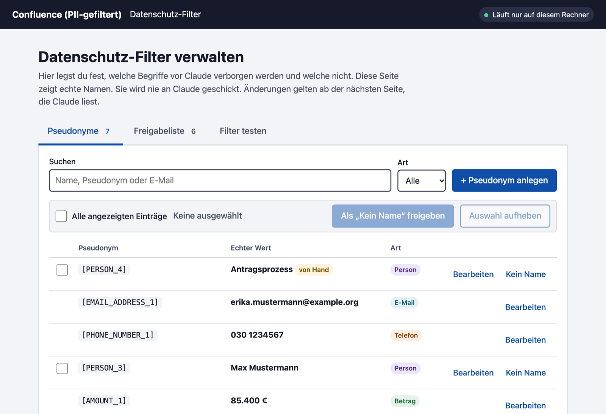
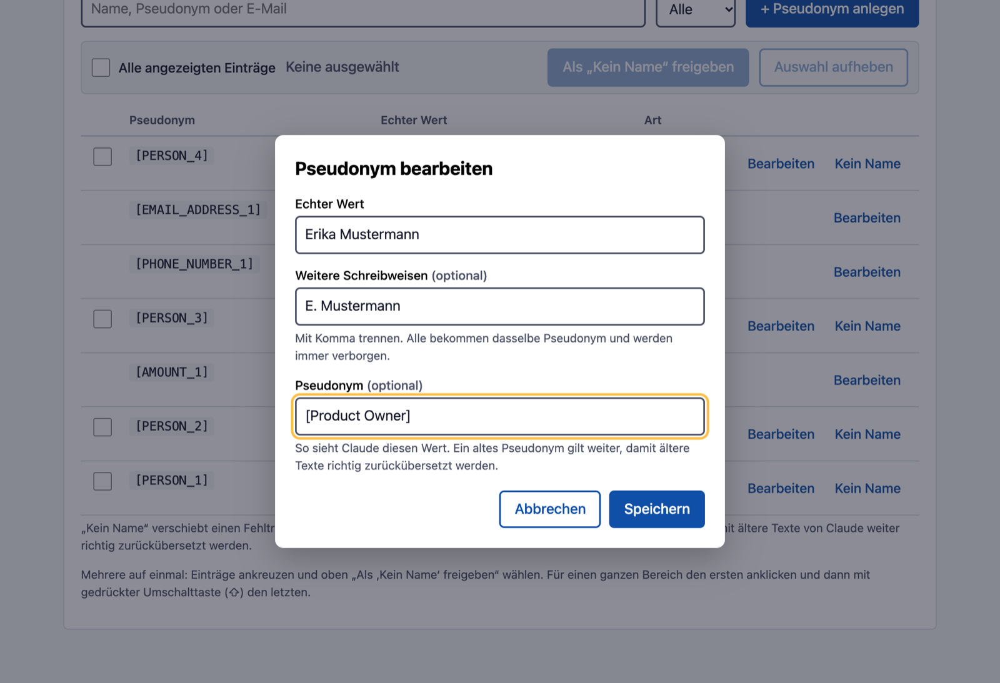
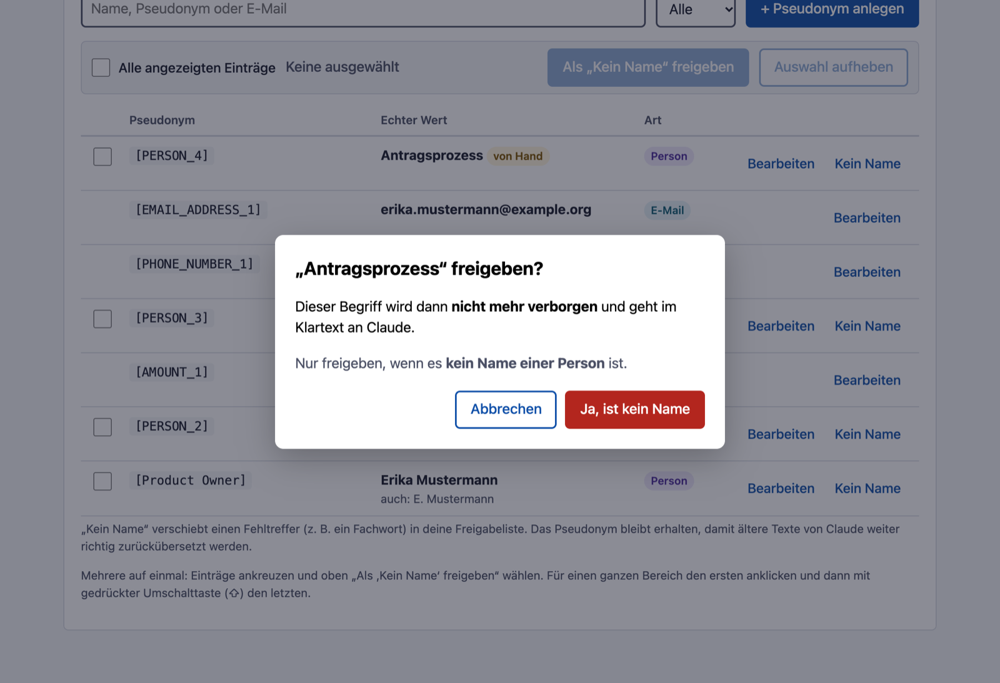
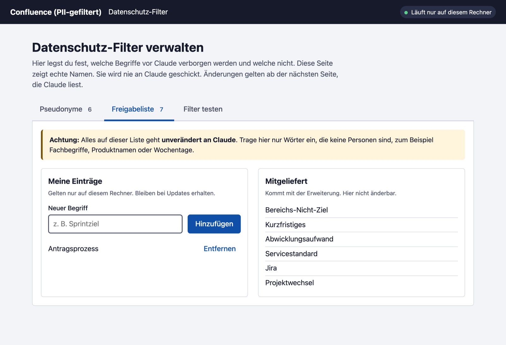
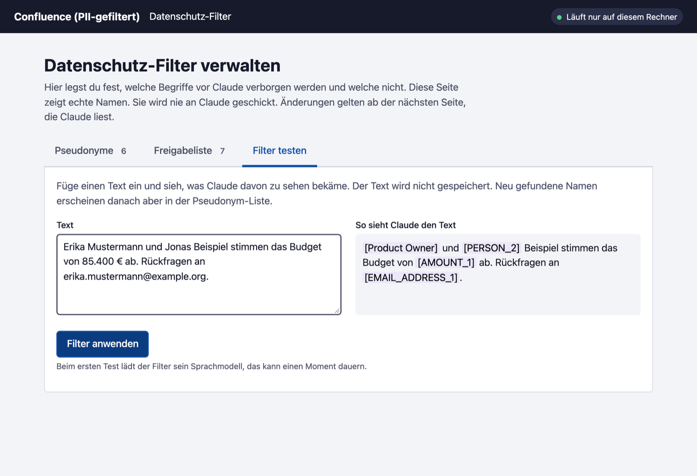

> **Hinweis:** Diese Anleitung wurde mit Unterstützung von Claude erarbeitet. Claude ist ein KI-Assistent (ein Programm mit künstlicher Intelligenz) der Firma Anthropic.

**Dauer:** ca. 20 Minuten, dazu einmalig ein Download von ca. 570 MB im Hintergrund
**Was du brauchst:** Claude Desktop (die Desktop-App von Claude) mit deinem Claude-Account, einen Confluence-Zugang bei DigitalService, einen GitHub-Account mit Einladung ins Projekt (siehe unten), einen Mac (die Anleitung ist für macOS geschrieben), einen Browser, ca. 570 MB freien Speicherplatz

Mit dieser Erweiterung kann Claude ausgewählte Confluence-Seiten lesen, durchsuchen und auf Wunsch ergänzen oder kommentieren. Du musst dann keine Seiten mehr kopieren und einfügen.

## Warum dieser Weg?

Der offizielle Atlassian-Connector ist bei DigitalService **für Confluence verboten** (siehe [Claude mit Jira verbinden](claude-mit-jira-verbinden.md)). Diese Erweiterung ist der erlaubte Weg, Confluence trotzdem mit Claude zu nutzen. Sie unterscheidet sich in drei Punkten:

- **Sie läuft nur auf deinem Rechner.** Es gibt keinen Server im Internet. Ist dein Rechner aus, läuft auch die Erweiterung nicht.
- **Sie filtert personenbezogene Daten heraus**, bevor Seiteninhalte an Claude gehen. Namen, E-Mail-Adressen, Telefonnummern und Euro-Beträge werden durch Platzhalter ersetzt.
- **Sie sieht nur, was du freigibst.** Du legst fest, welche Bereiche oder Seiten Claude lesen darf. Löschen kann Claude nie.

> **Wichtig:** Der Filter ist eine starke Hilfe, aber keine Garantie. Lies deshalb [Teil 6](#teil-6--so-funktioniert-der-datenschutz-filter), bevor du Seiten freigibst.

---

## Teil 1 – Zugang zum Projekt bekommen

Die Erweiterung liegt in einem privaten GitHub-Repository (ein Projektordner auf GitHub, den nur eingeladene Personen sehen).

1. Du brauchst einen GitHub-Account. Falls du noch keinen hast: [GitHub-Account einrichten](github-account-einrichten.md).
2. Bitte Leander Huth (Product Management) um eine Einladung ins Repository `leanderhuth-pm/confluence-mcp-server`. Schick dazu deinen GitHub-Benutzernamen mit.
3. Du bekommst von GitHub eine E-Mail mit der Einladung. Nimm sie an.

> **Hinweis:** Ohne angenommene Einladung funktionieren die Links in dieser Anleitung nicht. GitHub zeigt dann nur „404“ (Seite nicht gefunden).

## Teil 2 – Erweiterung herunterladen

1. Melde dich im Browser bei GitHub an.
2. Öffne die [Release-Seite der Erweiterung](https://github.com/leanderhuth-pm/confluence-mcp-server/releases/latest) (die Seite mit der aktuellen Version).
3. Lade die Datei `confluence-fs-local.mcpb` herunter. Sie landet meist im Ordner **Downloads**.

<!-- SCREENSHOT FEHLT: GitHub-Release-Seite der neuesten Version, Datei confluence-fs-local.mcpb unter den Dateien des Releases sichtbar und markiert → image/confluence-0-release-download.png -->

> **Tipp:** Lade die Datei immer von dieser Seite. Dann hast du automatisch die neueste Version.

## Teil 3 – API-Token erstellen

Ein API-Token ist ein langes Passwort, mit dem sich ein Programm in deinem Namen bei Confluence anmeldet. Die Erweiterung braucht es, um Seiten für dich zu lesen.

1. Öffne die [API-Token-Seite von Atlassian](https://id.atlassian.com/manage-profile/security/api-tokens) und melde dich mit deinem Confluence-Zugang an.
2. Klicke auf **API-Token erstellen** (englisch: **Create API token**).
   Nimm **nicht** die Variante mit Bereichen (englisch: „with scopes“).
3. Gib dem Token einen Namen, an dem du es wiedererkennst, zum Beispiel `Claude Confluence`.
4. Wähle ein Ablaufdatum. Danach funktioniert das Token nicht mehr und du brauchst ein neues.
5. Kopiere das Token. Du brauchst es gleich in Teil 4.

<!-- SCREENSHOT FEHLT: Atlassian-Seite „API-Token erstellen“ mit Feld für den Namen und Auswahl des Ablaufdatums (ohne echtes Token) → image/confluence-0-api-token.png -->

> **Wichtig:** Behandle das Token wie ein Passwort. Teile es mit niemandem und füge es nie in einen Chat ein, auch nicht bei Claude. Die Erweiterung speichert es sicher im Schlüsselbund deines Macs (der Passwort-Speicher von macOS).

> **Hinweis:** Atlassian zeigt das Token nur einmal an. Hast du es nicht kopiert, erstelle einfach ein neues.

## Teil 4 – Erweiterung installieren

1. Doppelklicke auf die Datei `confluence-fs-local.mcpb`.
2. Claude Desktop öffnet einen Installationsdialog für **Confluence (PII-gefiltert)**.
3. Fülle die Felder aus. Die Tabelle zeigt, was wohin gehört:

| Feld | Was du einträgst |
|---|---|
| **Deine Atlassian-E-Mail** | Die Adresse, mit der du dich bei Confluence anmeldest, z. B. `vorname.nachname@digitalservice.bund.de`. Pflichtfeld. |
| **Atlassian-API-Token** | Das Token aus Teil 3. Pflichtfeld. |
| **Bereichs-Schlüssel (optional, einer oder mehrere)** | Ganze Bereiche, auf die Claude zugreifen darf. Mehrere mit Komma trennen, z. B. `TEAM, FS`. Leer lassen, wenn du nur einzelne Seiten freigibst. |
| **Einzelne Seiten (optional)** | Seiten, auf die Claude zugreifen darf, ohne den ganzen Bereich freizugeben, jeweils mit allen Unterseiten. Seiten-URL einfügen oder nur die ID, mehrere mit Komma trennen. |
| **Gesperrte Seiten (optional)** | Seiten oder Ordner, die Claude nie lesen oder ändern darf, jeweils mit allen Unterseiten. Gilt auch innerhalb eines freigegebenen Bereichs. URL oder ID, mehrere mit Komma trennen. |
| **Claude-Konto (optional)** | Nur ausfüllen, wenn dein Claude-Konto eine andere E-Mail hat als dein Atlassian-Konto. Wird ins lokale Protokoll geschrieben. |

4. Bestätige die Installation im Dialog.

<!-- SCREENSHOT FEHLT: Installationsdialog von Claude Desktop für „Confluence (PII-gefiltert)“ mit allen sechs Feldern, Beispielwerte ohne echtes Token → image/confluence-0-install-dialog.png -->

> **Wichtig:** Bei **Bereichs-Schlüssel** oder **Einzelne Seiten** muss mindestens eins ausgefüllt sein. Sonst weiß die Erweiterung nicht, was Claude lesen darf.

### Wo finde ich Schlüssel und IDs?

Alles steht in der Adresszeile deines Browsers, wenn du die Seite in Confluence öffnest:

- **Bereichs-Schlüssel:** der Teil nach `/spaces/`.
  Beispiel: `…/wiki/spaces/TEAM/…` → Schlüssel `TEAM`
- **Seiten-ID:** die Zahl nach `/pages/`.
  Beispiel: `…/pages/123456789/Meine-Seite` → ID `123456789`
- **Ordner-ID** (für **Gesperrte Seiten**): die Zahl nach `/folder/`.
  Beispiel: `…/folder/987654321` → ID `987654321`

Du kannst auch einfach die ganze Adresse einfügen. Die Erweiterung sucht sich die ID selbst heraus.

### So wenig freigeben wie nötig

Jede Freigabe erlaubt Claude mehr Zugriff. Was Claude nicht lesen kann, kann auch nicht versehentlich in einer Antwort landen. Deshalb:

- **Lieber einzelne Seiten als ganze Bereiche.** Gib zum Beispiel nur die Projektseite deines Teams frei, nicht den ganzen Bereich.
- **Sensible Seiten sperren.** Liegen in einem freigegebenen Bereich Seiten zu People- oder HR-Themen, Verträgen oder Ähnlichem, trag sie bei **Gesperrte Seiten** ein.
- **Die Sperre gewinnt immer.** Eine gesperrte Seite bleibt tabu, auch wenn sie in einem freigegebenen Bereich liegt. Das gilt auch für alle ihre Unterseiten, auch für neue.

> **Hinweis:** Die Sperre schützt die Seite selbst, nicht Erwähnungen anderswo. Verlinkt eine andere Seite auf eine gesperrte Seite, sieht Claude dort den Titel. Kopien einer gesperrten Seite und Unterseiten, die jemand herausverschiebt, sind nicht mehr gesperrt. Wird eine gesperrte Seite gelöscht, sind ihre Unterseiten bis zum nächsten Start der Erweiterung sichtbar. Danach schaltet die Erweiterung alle Werkzeuge ab und Claude meldet, dass eine gesperrte Seite nicht gefunden wurde. Entferne dann die ID aus „Gesperrte Seiten“ (siehe Häufige Probleme).

## Teil 5 – Erster Start und Test

### Das Sprachmodell lädt einmalig

Beim ersten Start lädt die Erweiterung ein deutsches Sprachmodell herunter (ca. 570 MB). Das Modell ist ein Programm zur Namenserkennung, kein Chat-Programm wie Claude. Es wird im Ordner `~/.confluence-mcp/models` gespeichert (`~` steht für deinen persönlichen Benutzerordner).

Bis der Download fertig ist, gibt die Erweiterung keine Seiteninhalte heraus. Claude sagt dir das dann im Chat. So gehen keine Seiteninhalte ungefiltert an Claude. Warte ein paar Minuten und versuche es noch einmal.

### Verbindung testen

1. Starte in Claude Desktop einen neuen Chat.
2. Stelle eine Testfrage, zum Beispiel:
   `Zeig mir den Seitenbaum von TEAM.` (Ersetze `TEAM` durch deinen Bereichs-Schlüssel.)
   Hast du nur einzelne Seiten freigegeben, frag einfach: `Zeig mir den Seitenbaum meiner freigegebenen Confluence-Seiten.`
3. Claude fragt beim ersten Mal, ob es das Werkzeug nutzen darf. Klicke auf **Allow once** (einmal erlauben) oder **Always allow** (immer erlauben).
4. Claude zeigt dir eine Liste der Seiten. Dann hat alles geklappt.
5. Lass Claude jetzt eine Seite lesen, zum Beispiel: `Fasse die Seite „<Seitentitel>“ zusammen.`

<!-- SCREENSHOT FEHLT: Claude-Desktop-Chat mit der Testfrage und dem angezeigten Seitenbaum (Bereich mit unkritischen Seitentiteln) → image/confluence-0-erster-test.png -->

> **Tipp:** Für Werkzeuge, die nur lesen (Seite lesen, suchen, Seitenbaum, Kommentare lesen), ist **Always allow** in Ordnung. Für Werkzeuge, die schreiben (Seite anlegen, ändern, kommentieren, auf Kommentare antworten, Kommentare als erledigt markieren), wähle besser jedes Mal **Allow once**. So siehst du vorher, was Claude in Confluence schreiben will.

> **Gut zu wissen:** Stimmt etwas an deinen Angaben nicht, zum Beispiel ein falsches Token oder ein falscher Bereich, sagt Claude das im Chat und nennt die Stelle zum Korrigieren.

## Teil 6 – So funktioniert der Datenschutz-Filter

Bevor der Inhalt einer Confluence-Seite an Claude geht, prüft die Erweiterung ihn auf deinem Rechner. Erst danach verlässt der Text deinen Rechner. Seitentitel sind davon ausgenommen (siehe „Die Grenzen des Filters“).

### Was gefiltert wird

- **Namen von Personen**
- **E-Mail-Adressen**
- **Telefonnummern**
- **Euro-Beträge, aber nur mit Währungsangabe**, zum Beispiel `1.250.000,00 €`, `EUR 85.400`, `1,2 Mio. €` oder `230 TEUR`. Zahlen ohne Währung bleiben lesbar.

> **Hinweis:** Claude sieht maskierte Beträge nur als Platzhalter. Rechnen kann Claude damit also nicht.

### Wie der Filter arbeitet

1. **Erkennen:** Ein deutsches Sprachmodell sucht im Text nach Namen. Fachleute nennen das NER (Named Entity Recognition, auf Deutsch: Namenserkennung). Dazu kommt das Werkzeug Microsoft Presidio, das auch E-Mail-Adressen, Telefonnummern und Beträge findet. Alles läuft auf deinem Rechner.
2. **Ersetzen:** Jeder Fund wird durch einen Platzhalter ersetzt, zum Beispiel `[PERSON_1]`, `[EMAIL_ADDRESS_1]` oder `[AMOUNT_1]`. Dieselbe Person bekommt immer denselben Platzhalter. So versteht Claude trotzdem, wer was macht.
3. **Merken:** Welcher Platzhalter zu welchem echten Namen gehört, steht in einer Zuordnungstabelle (wir nennen sie Tresor). Der Tresor liegt nur auf deinem Rechner in `~/.confluence-mcp/pii_vault.db`. Er geht **nie** an Claude.
4. **Zurückübersetzen:** Schreibt Claude etwas nach Confluence und verwendet dabei einen Platzhalter, setzt die Erweiterung vorher wieder den echten Namen ein. In Confluence steht dann also „Erika Mustermann“, nicht `[PERSON_1]`.

### Ein Beispiel

So steht es in Confluence:

> Erika Mustermann und Jonas Beispiel stimmen das Budget von 85.400 € ab. Rückfragen an erika.mustermann@example.org.

So sieht Claude den Text (echtes Ergebnis des Filters):

> [PERSON_1] und [PERSON_2] Beispiel stimmen das Budget von [AMOUNT_1] ab. Rückfragen an [EMAIL_ADDRESS_1].

Fällt dir etwas auf? „Jonas Beispiel“ wurde nur zum Teil erkannt. Der Nachname geht im Klartext an Claude.

### Die Grenzen des Filters

Die Namenserkennung ist nicht perfekt. Das solltest du wissen:

- **Namen können durchrutschen.** Das passiert vor allem bei ungewöhnlichen Nachnamen und bei Namen in Tabellen oder Makros (Bausteine in Confluence, zum Beispiel Info-Kästen).
- **Es gibt auch Fehltreffer.** Manchmal hält der Filter ein Fachwort für einen Namen und verbirgt es.
- **Seitentitel werden nicht gefiltert.** Steht ein Name im Titel (zum Beispiel „1:1 Erika Mustermann“), sieht Claude ihn überall, wo Seiten aufgelistet oder gelesen werden. Solche Seiten sperrst du am besten (Teil 4).
- **Der Filter ist eine starke Abmilderung, keine Garantie.** Sperre deshalb Seiten mit besonders sensiblen Inhalten ganz (siehe Teil 4).

> **Wichtig:** Bist du unsicher, ob eine Seite freigegeben werden darf, frag beim Datenschutz nach: datenschutz@digitalservice.bund.de. Mehr dazu auch in Confluence auf der Seite [Claude-Regeln für Non-Engineers (WIP)](https://digitalservicebund.atlassian.net/wiki/spaces/DIGITALSER/pages/3375300680).

### Weitere Schutzmechanismen

- **Nur Freigegebenes:** Claude kommt nur an die Bereiche und Seiten, die du eingetragen hast. Alles andere wird abgelehnt, auch beim Lesen.
- **Gesperrte Seiten:** Sie tauchen weder in der Suche noch im Seitenbaum auf.
- **Kein Löschen:** Die Erweiterung hat gar keine Funktion zum Löschen. Claude kann also keine Seite löschen, auch nicht aus Versehen. Beim Ändern einer Seite kann Claude aber Inhalte entfernen. Frühere Fassungen findest du im Seitenverlauf von Confluence.
- **Kein Überschreiben fremder Änderungen:** Claude kann eine Seite nur auf Basis der Version ändern, die es zuletzt gelesen hat. Hat jemand die Seite inzwischen geändert, wird nichts gespeichert.
- **Protokoll:** Jeder Zugriff wird auf deinem Rechner in `~/.confluence-mcp/audit.jsonl` festgehalten: wann welche Seiten übertragen wurden, in welche Richtung, unter welchem Konto und von welchem Rechner. Seitentitel und Suchbegriffe stehen darin, die Inhalte selbst nicht.

## Teil 7 – Den Filter selbst verwalten

Du kannst den Filter selbst nachschärfen. Dafür gibt es die Filter-Verwaltung, eine kleine Seite in deinem Browser.

**So öffnest du sie:** Schreib Claude im Chat:
`Öffne die Datenschutz-Filter-Verwaltung.`
Dein Browser öffnet die Seite **Datenschutz-Filter verwalten**.

> **Hinweis:** Die Seite läuft nur auf deinem Rechner (oben rechts steht **Läuft nur auf diesem Rechner**). Sie zeigt echte Namen. Claude sieht die Seite nicht und bekommt nur die Meldung, dass sie geöffnet wurde.

> **Hinweis zu den Bildern:** Alle Namen und Adressen in den Bildern sind erfunden (Demo-Daten).

Änderungen gelten ab der nächsten Seite, die Claude liest. Du musst nichts neu starten.

### Pseudonyme ansehen

Im Reiter **Pseudonyme** siehst du alle Platzhalter (Pseudonyme) mit ihrem echten Wert.



- Über **Suchen** findest du einen Namen, ein Pseudonym oder eine E-Mail-Adresse.
- Über **Art** filterst du zum Beispiel nur nach **Person**, **E-Mail**, **Telefon** oder **Betrag**.
- Neben jedem Eintrag stehen **Bearbeiten** und bei Personen zusätzlich **Kein Name**.

### Eigenes Pseudonym und weitere Schreibweisen

Klicke bei einem Eintrag auf **Bearbeiten**. Es öffnet sich das Fenster **Pseudonym bearbeiten**.



- **Pseudonym (optional):** Hier gibst du einen sprechenden Platzhalter ein, zum Beispiel `[Product Owner]` statt `[PERSON_1]`. Dann versteht Claude die Rolle besser, ohne den Namen zu kennen.
- **Weitere Schreibweisen (optional):** Hier trägst du andere Schreibweisen derselben Person ein, zum Beispiel `E. Mustermann`. Mehrere mit Komma trennen. Alle bekommen dasselbe Pseudonym und werden immer verborgen. Das hilft gegen Varianten, die der Filter sonst übersieht.
- Klicke auf **Speichern**.

> **Gut zu wissen:** Das alte Pseudonym bleibt gültig. So werden ältere Texte von Claude weiter richtig zurückübersetzt.

Fehlt ein Name ganz in der Liste, legst du ihn über **+ Pseudonym anlegen** von Hand an.

### Fehltreffer freigeben („Kein Name“)

Manchmal hält der Filter ein Fachwort für einen Namen. Im Bild steht dafür das Beispiel „Antragsprozess“. Es trägt das Etikett **von Hand**, weil es für die Demo von Hand angelegt wurde. Vom Filter gefundene Einträge haben dieses Etikett nicht.

1. Klicke beim Eintrag auf **Kein Name**.
2. Es erscheint die Frage **„Antragsprozess“ freigeben?**
3. Klicke auf **Ja, ist kein Name**.



Der Begriff wird dann nicht mehr verborgen und geht im Klartext an Claude. Gib nur frei, wenn es **kein Name einer Person** ist.

> **Tipp:** Mehrere auf einmal: Kreuze die Einträge an und klicke oben auf **Als „Kein Name“ freigeben**. Für viele Einträge am Stück setzt du beim ersten Eintrag einen Haken und hakst dann mit gedrückter Umschalttaste (⇧) den letzten an.

### Freigabeliste

Im Reiter **Freigabeliste** stehen alle Begriffe, die der Filter nie verbirgt.



- **Meine Einträge:** Deine eigenen Begriffe. Sie gelten nur auf diesem Rechner und bleiben bei Updates erhalten (gespeichert in `~/.confluence-mcp/pii_allowlist.txt`). Neue Begriffe trägst du bei **Neuer Begriff** ein und klickst auf **Hinzufügen**. Mit **Entfernen** nimmst du einen Begriff wieder heraus.
- **Mitgeliefert:** Begriffe, die mit der Erweiterung kommen. Hier kannst du nichts ändern.

> **Wichtig:** Trag hier **nie echte Namen** ein. Alles auf dieser Liste geht unverändert an Claude. Geeignet sind Fachbegriffe, Produktnamen oder Wochentage.

### Filter testen

Im Reiter **Filter testen** siehst du, was Claude von einem Text zu sehen bekäme. Das ist praktisch, bevor du eine neue Seite freigibst.

1. Kopiere einen Text aus Confluence in das Feld **Text**.
2. Klicke auf **Filter anwenden**.
3. Rechts unter **So sieht Claude den Text** erscheint das Ergebnis.



Im Bild steht `[Product Owner]` statt `[PERSON_1]`, weil für Erika Mustermann vorher ein eigenes Pseudonym vergeben wurde (siehe oben).

Der Text wird nicht gespeichert. Neu gefundene Namen erscheinen danach aber im Reiter **Pseudonyme**. Beim ersten Test lädt der Filter sein Sprachmodell. Das kann einen Moment dauern.

> **Tipp:** Siehst du im Ergebnis einen Namen ganz oder teilweise im Klartext, wie bei `[PERSON_2] Beispiel`, ergänze ihn: Öffne den Reiter **Pseudonyme**, klicke beim passenden Eintrag auf **Bearbeiten** und trag bei **Weitere Schreibweisen** den vollen Namen `Jonas Beispiel` ein. Fehlt die Person ganz, nutze **+ Pseudonym anlegen**. Teste danach noch einmal.

## Teil 8 – Einstellungen ändern und Updates

### Einstellungen ändern

Du willst einen Bereich hinzufügen, eine Seite sperren oder ein neues Token eintragen?

1. Öffne in Claude Desktop die **Einstellungen** → **Erweiterungen**.
2. Wähle **Confluence (PII-gefiltert)**.
3. Ändere die Felder wie in Teil 4.

<!-- PRÜFEN: genaue Beschriftung von „Einstellungen → Erweiterungen“ in Claude Desktop (deutsche bzw. englische Oberfläche) -->

### Updates installieren

1. Lade die neue Datei `confluence-fs-local.mcpb` von der [Release-Seite](https://github.com/leanderhuth-pm/confluence-mcp-server/releases/latest) herunter.
2. Doppelklicke darauf und installiere sie wie in Teil 4.

> **Gut zu wissen:** Deine Pseudonyme und deine Freigabeliste bleiben bei einem Update erhalten.

## Für Fortgeschrittene: Claude Code

Nutzt du Claude Code (die Version von Claude für das Terminal), kannst du die Erweiterung als Plugin installieren. Du brauchst auch hier die Einladung aus Teil 1.

1. Installiere das Hilfsprogramm uv im Terminal:
   ```
   brew install uv
   ```
2. Gib in Claude Code nacheinander ein:
   ```
   /plugin marketplace add leanderhuth-pm/confluence-mcp-server
   /plugin install confluence-fs@digitalservice-confluence
   ```
3. Beim Aktivieren fragt Claude Code nach denselben Angaben wie in Teil 4. Das Token landet auch hier im Schlüsselbund.
4. Ändern kannst du die Angaben über `/plugin` → `confluence-fs`.
5. Updates holst du mit:
   ```
   /plugin marketplace update digitalservice-confluence
   ```

> **Hinweis:** Schlägt `marketplace add` fehl, fehlt meist die Einladung ins Repository oder du bist bei GitHub nicht angemeldet.

---

## Checkliste

- [ ] Einladung ins GitHub-Repository angenommen
- [ ] `confluence-fs-local.mcpb` von der Release-Seite heruntergeladen
- [ ] API-Token erstellt (ohne Bereiche) und sicher eingetragen, nirgends sonst gespeichert
- [ ] Erweiterung installiert, Bereich **oder** einzelne Seiten eingetragen
- [ ] Sensible Seiten bei **Gesperrte Seiten** eingetragen
- [ ] Sprachmodell geladen und Seitenbaum im Chat angezeigt bekommen
- [ ] Schreibende Werkzeuge nicht auf **Always allow** gestellt
- [ ] Filter-Verwaltung einmal geöffnet und eine Seite mit **Filter testen** geprüft

## Häufige Probleme

| Problem | Lösung |
|---|---|
| GitHub zeigt beim Download „404“ | Die Einladung fehlt oder ist noch nicht angenommen, oder du bist bei GitHub nicht angemeldet. Prüfe beides (Teil 1). |
| Claude meldet, das Token sei ungültig | Erstelle ein neues Token (Teil 3) und trag es unter **Einstellungen** → **Erweiterungen** → **Confluence (PII-gefiltert)** ein. Vielleicht ist das alte abgelaufen. |
| Claude sagt, eine Seite sei nicht freigegeben | Der Bereich oder die Seite fehlt in deinen Einstellungen, oder die Seite ist gesperrt. Prüfe die Felder (Teil 8). |
| Claude liest keine Seiteninhalte und verweist auf das Sprachmodell | Das Sprachmodell lädt noch (ca. 570 MB). Warte ein paar Minuten und versuche es erneut. |
| Claude meldet, eine gesperrte Seite wurde nicht gefunden, und nichts geht mehr | Eine ID bei **Gesperrte Seiten** ist falsch, die Seite wurde gelöscht, oder dein Account hat keinen Zugriff auf diese Seite. Zur Sicherheit sind alle Werkzeuge abgeschaltet. Korrigiere die ID oder nimm sie aus der Liste. |
| Du siehst einen Namen im Klartext bei Claude | Öffne die Filter-Verwaltung und leg den Namen als Pseudonym an oder ergänze ihn als weitere Schreibweise (Teil 7). |
| Ein Fachwort wird verborgen | Gib es in der Filter-Verwaltung über **Kein Name** frei (Teil 7). |
| Claude kann mit einem Betrag nicht rechnen | Beträge mit Währungsangabe werden absichtlich verborgen. Das ist so gewollt. |

**Nächster Schritt:** Zurück zur [Übersicht](../index.md).
