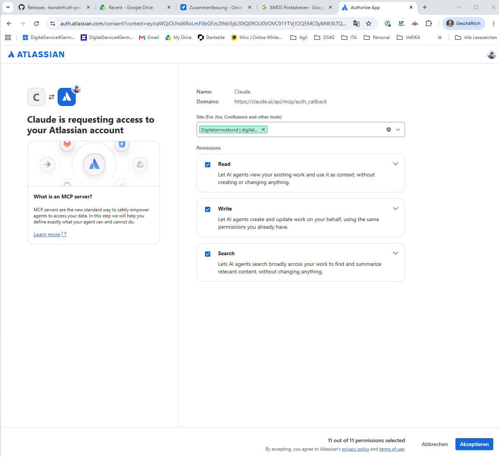
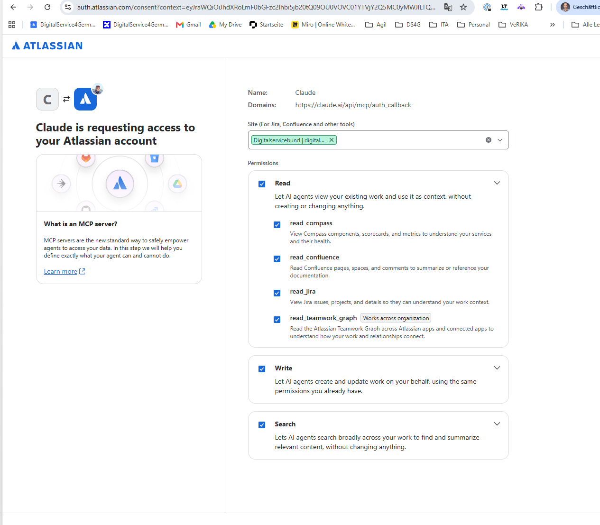
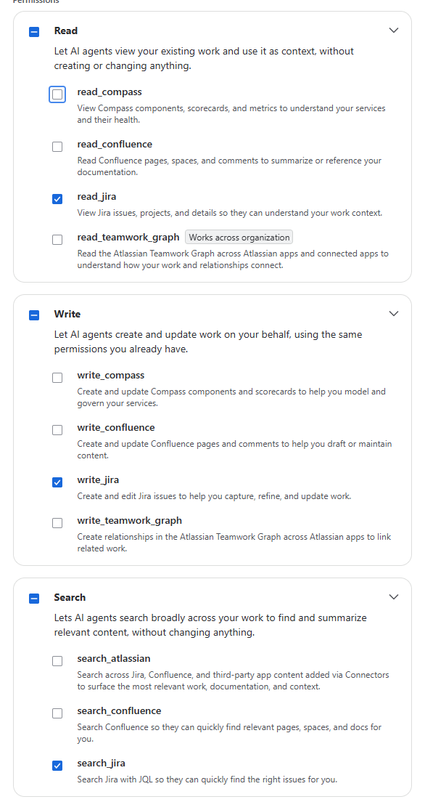

# Kurzanleitung: Claude Desktop mit Jira verbinden

> **Hinweis:** Diese Anleitung wurde mit Unterstützung von Claude erarbeitet. Claude ist ein KI-Assistent (ein Programm mit künstlicher Intelligenz) der Firma Anthropic.

**Dauer:** ca. 10 Minuten
**Was du brauchst:** Claude Desktop (die Desktop-App von Claude) mit deinem Claude-Account, einen Jira-Zugang deiner Organisation, einen Browser

Mit dem Jira-Connector (eine Verbindung zwischen Claude und einem anderen Dienst) kann Claude deine Jira-Tickets lesen, suchen und auf Wunsch anlegen oder ändern. Du musst dann keine Tickets mehr kopieren und einfügen.

> **Wichtig:** Der Connector heißt **Atlassian**. Er kann neben Jira auch Confluence und weitere Atlassian-Tools verbinden. Bei DigitalService ist **nur Jira** erlaubt. Confluence über diesen Connector ist verboten. In Teil 2 schaltest du deshalb alles außer Jira ab.

---

## Teil 1 – Connector in Claude Desktop hinzufügen

1. Öffne **Claude Desktop**.
2. Klicke unten links auf deinen Namen → **Settings** (deutsch: **Einstellungen**).
3. Öffne **Connectors**.
4. Klicke auf **Browse connectors** und suche nach `Atlassian`.
5. Klicke beim Connector **Atlassian** auf **Connect**.
6. Dein Browser öffnet sich mit der Anmeldeseite von Atlassian. Melde dich mit deinem Jira-Zugang an, falls du noch nicht angemeldet bist.

> **Hinweis:** Findest du den Connector nicht, ist er für deine Organisation vielleicht nicht freigeschaltet. Frag dann in deinem Team nach, wer Claude bei euch betreut.

## Teil 2 – Zugriff auf Jira beschränken

Atlassian zeigt jetzt die Seite **Claude is requesting access to your Atlassian account**. Hier legst du fest, was Claude darf. Am Anfang ist **alles** angehakt (unten steht „11 out of 11 permissions selected“).

1. **Site prüfen:** Unter **Site (For Jira, Confluence and other tools)** muss die Jira-Seite deiner Organisation stehen. Steht dort eine andere, wähle über den Pfeil rechts die richtige aus.
2. **Bereiche aufklappen:** Klicke bei **Read**, **Write** und **Search** jeweils rechts auf den Pfeil. Jetzt siehst du die einzelnen Berechtigungen.

   

3. **Alles außer Jira abwählen:** Entferne die Haken bei allen Berechtigungen, die nicht auf `_jira` enden. Es bleiben nur diese drei:
   - `read_jira` – Jira-Tickets und Projekte lesen
   - `write_jira` – Jira-Tickets anlegen und ändern
   - `search_jira` – Jira-Tickets durchsuchen

   

4. **Prüfen:** Unten steht jetzt „3 out of 11 permissions selected“. Vor **Read**, **Write** und **Search** ist statt eines Hakens ein Strich zu sehen. Das heißt: Nur ein Teil ist ausgewählt.
5. Klicke unten rechts auf **Akzeptieren**.
6. Der Browser meldet, dass die Verbindung steht. Wechsle zurück zu Claude Desktop.

> **Hinweis:** Willst du nur lesen und nichts ändern lassen, entferne auch den Haken bei `write_jira`. Claude kann dann keine Tickets anlegen oder bearbeiten.

> **Warum so streng?** Jeder Haken erlaubt Claude mehr Zugriff. Was Claude nicht lesen kann, kann auch nicht versehentlich in einer Antwort landen. Außerdem ist Confluence über diesen Connector bei uns nicht erlaubt.

## Teil 3 – Verbindung testen

1. Starte in Claude Desktop einen neuen Chat.
2. Klicke unten im Eingabefeld auf **+** (oder das Werkzeug-Symbol) und prüfe, dass **Atlassian** eingeschaltet ist.
3. Stelle eine Testfrage, zum Beispiel:
   `Zeige mir meine offenen Jira-Tickets.`
4. Claude fragt beim ersten Mal, ob es das Jira-Werkzeug nutzen darf. Klicke auf **Allow once** (einmal erlauben) oder **Always allow** (immer erlauben).
5. Claude zeigt dir eine Liste deiner Tickets. Dann hat alles geklappt.

> **Tipp:** Lass Claude bei Änderungen am besten immer fragen. Wähle bei Werkzeugen, die Tickets anlegen oder ändern, nicht **Always allow**. So siehst du vorher, was Claude in Jira schreiben will.

> **Gut zu wissen:** Der Connector gehört zu deinem Claude-Account. Er funktioniert deshalb auch in Claude im Browser (<https://claude.ai>) und in der Mobile App.

---

## Checkliste

- [ ] Connector **Atlassian** in Claude Desktop hinzugefügt
- [ ] Bei Atlassian angemeldet und die richtige Site ausgewählt
- [ ] Nur `read_jira`, `write_jira` und `search_jira` angehakt („3 out of 11“)
- [ ] Auf **Akzeptieren** geklickt
- [ ] Testfrage gestellt und Tickets angezeigt bekommen

## Häufige Probleme

| Problem | Lösung |
|---|---|
| Connector **Atlassian** wird nicht angezeigt | Er ist für deine Organisation vermutlich nicht freigeschaltet. Frag in deinem Team nach. |
| Aus Versehen alles angehakt und akzeptiert | **Settings → Connectors** öffnen, beim Connector **Atlassian** auf **Disconnect** klicken und Teil 1 und 2 neu durchgehen. |
| Falsche Site ausgewählt | Wie oben trennen und neu verbinden. In Teil 2 die richtige Site wählen. |
| Claude sagt, es habe keinen Zugriff auf Jira | Im Chat über **+** prüfen, ob **Atlassian** eingeschaltet ist. |
| Claude findet ein Ticket nicht | Claude sieht nur Projekte, die du selbst in Jira sehen darfst. Prüfe in Jira, ob du Zugriff auf das Projekt hast. |
| Browser öffnet sich nicht | In Claude Desktop erneut auf **Connect** klicken. Prüfe, ob ein Pop-up-Blocker die Seite verhindert. |

**Nächster Schritt:** Zurück zur [Übersicht](uebersicht.md).
